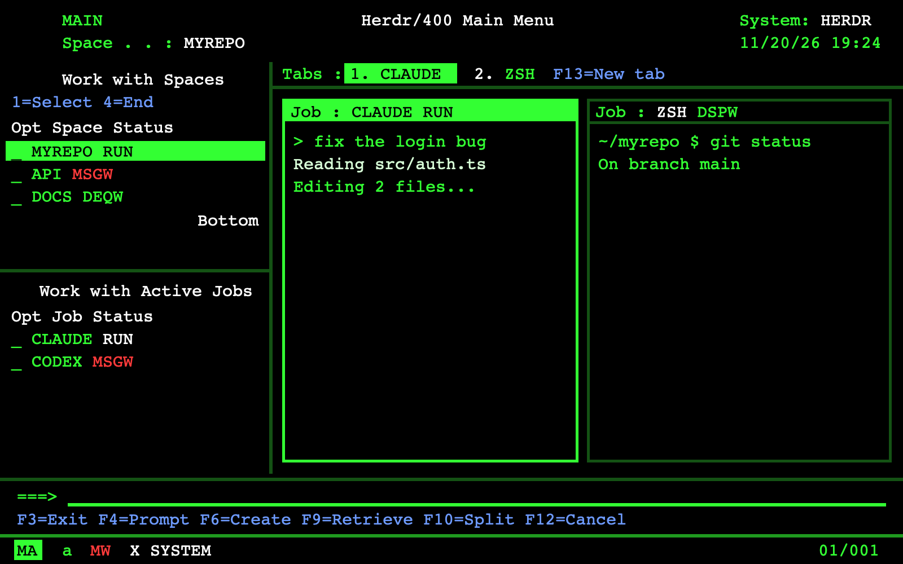

# herdr-ibm-as400

A [Herdr App](https://github.com/herdrdev/herdr-app) layout that turns the window into an IBM AS/400 5250 green screen: spaces on a "Work with Spaces" list, agents on "Work with Active Jobs" (a blocked agent is `MSGW`), a `===>` command line that takes CL-style commands, function keys and the operator information area.

## Install

Ask your agent in Herdr App to add `github.com/masahosono/herdr-ibm-as400`, or copy by hand:

- `layouts/ibm-as400.json` and `layouts/ibm-as400.svg` → `~/.config/herdr-app/layouts/`
- `mods/ibm-as400/` → `~/.config/herdr-app/mods/`

Then switch to it with `layout.switch` (Cmd+Shift+L on macOS).

Before installing: the `ibm-as400` mod runs `hostname -s` once to show the system name. It reaches no network and writes no files.

See [RECIPE.md](RECIPE.md) for what it does and how it's built.

## License

MIT. See [LICENSE](LICENSE). The bundled IBM 3270 font (`mods/ibm-as400/fonts/3270-Regular.ttf`) is by Ricardo Banffy and others, BSD-3-Clause, see `mods/ibm-as400/fonts/LICENSE-3270.txt`.
