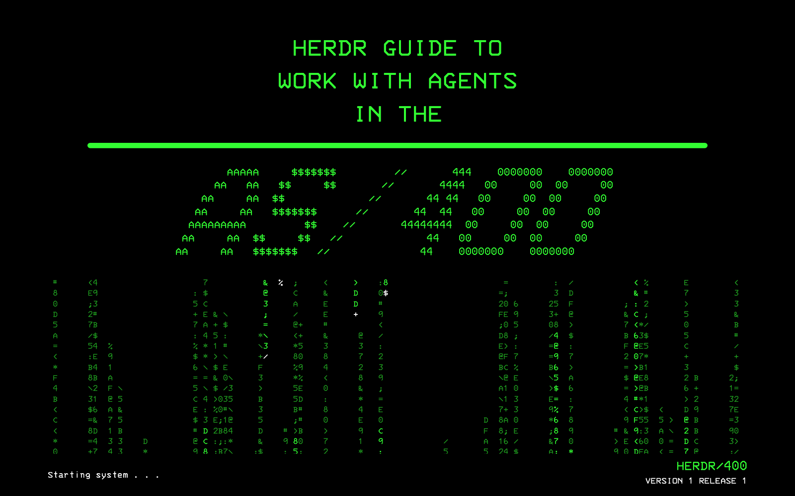

# IBM AS/400

Herdr as an IBM AS/400 5250 green screen: green and white text on black in a mainframe terminal font, spaces on a "Work with Spaces" list, agents on "Work with Active Jobs" where a working, blocked or finished agent blinks `RUN`, `MSGW` (red) or `OUTQ`, tabs as a numbered menu line, panes framed with `Job . . :` headers, and a `===>` command line with function keys and the operator information area (`MA`, `MW`, `X SYSTEM`) at the bottom.

## What you see

Top to bottom; everything is black (`#000000`) with no title bar; traffic lights at (14, 14). All text is the bundled IBM 3270 font, 15px in panels, 17px in terminals. Colors: green `#33ff33`, white `#ffffff` (titles, values), blue `#6e9bff` (options and function keys), red `#ff3b3b`, yellow `#ffff3c`, dim green `#1f9a1f`, line green `#145214` (dividers, unfocused frames, hover). Every text row is 20px.

- **Header** (48px, drags the window, 84px left room for the traffic lights), two lines:
  - `MAIN` in green, `Herdr/400 Main Menu` centered in white, `System:` and the short host name upper-cased (8 characters, `HERDR` until known) on the right.
  - `Space . . . :` and the active space's name upper-cased in white, `Tab . . :` `n of m`, `Branch . . :` and its branch (`*NONE` without one), and on the right the date and time as `MM/DD/YY  HH:MM` in green (updated every 10s).
- **Screen** row (1px line-green dividers):
  - **Sidebar** (330px, min 240, max 560), two halves of equal weight (min 120 each):
    - **Work with Spaces**: the title centered in white; `Click Opt for options.` and `  1=Select  2=Rename  4=End  7=New tab` in blue; then a white column header `Opt  Space  Tabs  Status`. One row per space: an `_` Opt field, the name upper-cased, the tab count, and its status as a job status. The active space is in reverse video (green background, black text); others hover line green. Below the rows, `Bottom` right-aligned in white (`(No spaces)` when empty). Scrolls.
    - **Work with Active Jobs**: the title; `Active jobs . . . :` count and `MSGW:` count (red when not 0); `  4=End  5=Work with  8=Peek` in blue; a header `Opt  Job  Space  Status`; one row per agent: `_`, the program name as an object name (upper case, no blanks, at most 10 characters, e.g. `CLAUDECODE`), the space name, its job status. The focused agent is in reverse video. `Bottom` at the end.
  - **Work area**:
    - **Tabs** (28px, drags the window, line-green bottom border): `Tabs . . :` then each tab as `n. NAME` (white number, green name: the tab's name if named, else its focused pane's program, upper-cased, max 180px) and its job status if it has agents. The active tab is in reverse video. Last, `F13=New tab` in blue.
    - **Panes** (8px padding): the active tab's panes, every pane framed (also a lone one): black, no radius, 8px gap, 1px line-green border, 1px green when focused. A 22px header on top: `Job . . :` program object name, `Number . . :` its terminal address, `Dir . :` its folder (`~` for home, truncated), the job status, then `F11=Zoom` (`F11=Restore` when zoomed) and `F16=End` in blue. The focused pane's header is in reverse video.
- **Console** (86px, full width, line-green top border):
  - `===>` in green, then the command input (white text, green underline).
  - The function keys in blue: `F3=Exit F4=Prompt F6=Create F9=Retrieve F10=Split F11=Zoom F12=Cancel F24=More keys`, or after F24 `F7=Prev tab F8=Next tab F13=New tab F14=Split down F16=End pane F17=Settings F18=Help F24=More keys`.
  - The message line: the last command's message in white, an error in red.
  - The operator information area (dim-green top border): `MA` in reverse video, `a`, `MW` in red blinking while any agent is blocked, `X SYSTEM` in white while any agent works (both invisible otherwise, keeping their place), and on the right `RUN n  MSGW n` in dim green and the position `SS/TTT` (active space and tab index, e.g. `08/001`) in green.

## How it behaves

- **Title screen**: when Herdr starts with this layout on (the app process is under 45 seconds old), a full-window black screen shows for 3 seconds: `HERDR GUIDE TO` / `WORK WITH AGENTS` / `IN THE` in large green letters, a thick green bar, `AS/400` in slanted block letters drawn with `A`, `$`, `/`, `4` and `0`, green characters falling below it (white heads, green tails fading to dim green), and at the bottom `Starting system . . .` blinking in white and `HERDR/400` / `VERSION 1 RELEASE 1` on the right. A click or any key closes it early. Switching to the layout later doesn't show it; `DSPLOGO` on the command line does.
- **Agent status as job status** (sidebar rows, tab items, pane headers): working is `RUN` in white, blocked `MSGW` in red, done `OUTQ` in yellow, idle `DEQW` in green. `RUN`, `MSGW` and `OUTQ` blink (opacity 0.15 to 1, 1000ms); `DEQW` and `DSPW` don't. A pane without an agent (a shell, an editor) is `DSPW` in dim green. A space row with no agents shows no status. In reverse video the status text is black and doesn't blink.
- **Space row**: a click selects the space (`space.select`). A click on its `_` or a right-click opens its options.
- **Job row**: a click focuses the agent (`agent.focus`). `_` or right-click opens its options.
- **Tab item**: a click selects it (`tab.select`); right-click opens its options. `F13=New tab` makes a tab in the active space.
- **Pane header**: a click focuses the pane, a double-click zooms it. `F11` zooms or restores, `F16` closes the pane.
- **Options popup** (300px wide, 2px blue border, drawn by the mod, `frame: "none"`): `Work with Space` / `Tab` / `Job` in white, the row's name, `Type option or click:` in blue, the options in green (hover in reverse video), `F12=Cancel`. Typing the option's digit or clicking it closes the popup and runs it; F12 or Esc closes it.
  - Space: `1=Select` (`space.select`), `2=Rename` (`space.rename`, Herdr asks the name), `4=End` (`space.close`, Herdr asks to confirm), `7=New tab` (`tab.new {space}`).
  - Tab: `1=Select`, `2=Rename` (`tab.rename`), `4=End` (`tab.close`).
  - Job: `5=Work with` (`agent.focus`), `8=Peek` (`terminal.peek`), `4=End` (`terminal.kill`).
- **Command line** (Enter runs it, case-insensitive verbs):
  - `n` or `GO n`: select the n-th space.
  - `CRTSPC [name]`, `ENDSPC`, `RNMSPC [name]`: `space.new`, `space.close`, `space.rename`.
  - `CRTTAB [name]`, `ENDTAB`, `RNMTAB [name]`: `tab.new`, `tab.close`, `tab.rename`.
  - `CALL prog args` or `STRAGT prog args`: a new tab running it (`tab.new {argv}`); `CALL PGM(claude)` and `CALL PGM('claude --resume')` work too.
  - `SBMJOB prog args`: the same in the background (`focus: false`), "Job X submitted to job queue QBATCH in library QGPL."
  - `DSPLOGO`: the title screen.
  - `SPLIT` / `SPLIT DOWN`: `pane.split`. `WRKCFG`: settings. `HELP`: `app.help`. `SIGNOFF`: `layout.switch` to the next layout.
  - Anything else: `CPD0030 Command X in library *LIBL not found.` in red.
- **Function keys**: click a key on the line, or press it while the command line has the keyboard. F3 `layout.switch` (next layout), F4 `app.palette`, F6 `space.new`, F9 puts the previous commands back in the input one by one, F10 split right, F11 `pane.zoom`, F12 clears the input and the message, F24 swaps the key set; F7/F8 `tab.prev`/`tab.next`, F13 `tab.new`, F14 split down, F16 `pane.close`, F17 `app.settings`, F18 `app.help`.
- The Jobs list sets the agent order (`setAgentOrder`), so `agent.next` / `agent.prev` follow it.

## Built from

- **Layout** `layouts/ibm-as400.json`: `root` column [`header` block, `screen` row [`sidebar` column [`spaces`, `jobs`], `work` column [`tabs`, `main` (`tab: active` with pane frames and a `pane` header)]], `console` block]. Every block is the `ibm-as400` mod with props `{ view }`: `header`, `spaces`, `jobs`, `tabs`, `pane` (the pane header), `console`. Root look: `theme: "graphite"` with every color overridden in `colors` (background, chrome, canvas, surface, popover all `#000000`; foreground and accent `#33ff33`; status colors; `ansi0`..`ansi15` as the 5250 palette), `font` and `ui_font` `IBM 3270`, `font_size` 17, `terminal_padding` [8, 6], `titlebar: "none"`, `preview: "layouts/ibm-as400.svg"`.
- **Mod** `ibm-as400` (MIT): one `View`; `props().view` picks `init_<view>` / `draw_<view>`. Its popup is the view `opt`, opened with `openOverlay({ kind: "popup", frame: "none" })`; the title screen is the view `boot`, a modal `dialog` with `frame: "none"` at width and height 1, opened by the `header` view when `ps -o etime= -p $PPID` says Herdr started under 45 seconds ago. It uses `spaces`, `agents`, `panes`, `setAgentOrder`, `exec("hostname", ["-s"])` once, `InputState` / `Input` from `gpui-base`, and `.loop("opacity")` for the blink. Commands: `space.select/new/close/rename`, `tab.select/new/close/rename/prev/next`, `pane.focus/zoom/split/close`, `agent.focus`, `terminal.peek/kill`, `layout.switch`, `app.palette/settings/help`.
- **Font**: `mods/ibm-as400/fonts/3270-Regular.ttf` (family `IBM 3270`, v3.0.1 from github.com/rbanffy/3270font, BSD-3-Clause, license in `fonts/LICENSE-3270.txt`). Herdr loads fonts from a mod's `fonts/` folder.
- **Art**: `layouts/ibm-as400.svg` (the settings picture) is the top of the title screen (the title, the bar and the AS/400 logo from `preview.svg`, cropped to 760×475 so the thumbnail stays legible; the font URL is relative to `layouts/`); `preview.png` is `preview.svg` rendered at 1600×1000.
- No shipped mods are used.

## Watch out

- `herdr-app check` gives no props, so it only checks the default view (`spaces`); check the other views from a copy with the default changed.
- An underlined `_` draws as `=`: the Opt field is a plain `_`.
- The function keys reach the mod only while the command line (or the console) has the keyboard; elsewhere they go to the terminal. There is no `keys.json`.
- The font loads at start and on a look change; if `IBM 3270` doesn't show after installing, switch layouts once or restart.
- Not tested on Linux or Windows; `hostname -s` may not exist there (the name stays `HERDR`). Multiple machines aren't grouped: their spaces are listed in Herdr's order.
- `4=End` on a job kills its terminal at once (`terminal.kill`), without asking.

## Done when

- The window is black and green in the IBM 3270 font, with `Herdr/400 Main Menu` on top and the OIA at the bottom.
- Clicking a space row selects it and turns it reverse video; the header shows its name.
- An agent that starts working blinks `RUN` on its job row, tab and pane header, and `X SYSTEM` appears; a blocked one blinks `MSGW` and `MW`.
- Right-clicking a space opens `Work with Space`; typing `7` makes a new tab there.
- Typing `CALL claude` on the command line opens a tab running claude; `FOO` shows `CPD0030 Command FOO in library *LIBL not found.`
- Restarting Herdr shows the title screen with falling characters for 3 seconds; `DSPLOGO` shows it again.
- Clicking `F24=More keys` swaps the key line; `F11=Zoom` on a pane header zooms it.
